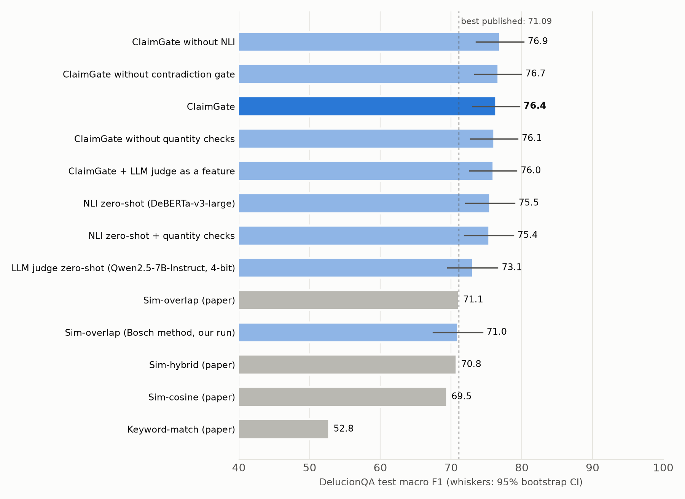
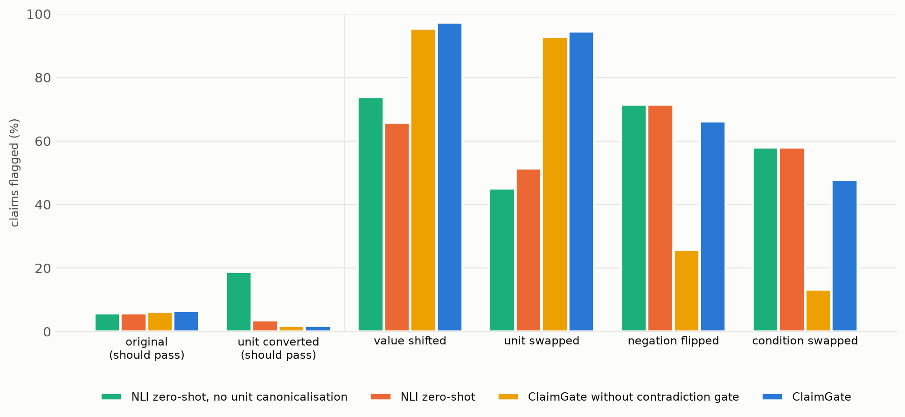
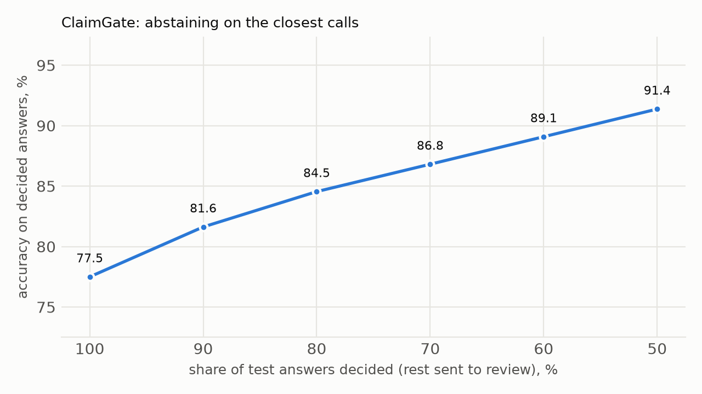
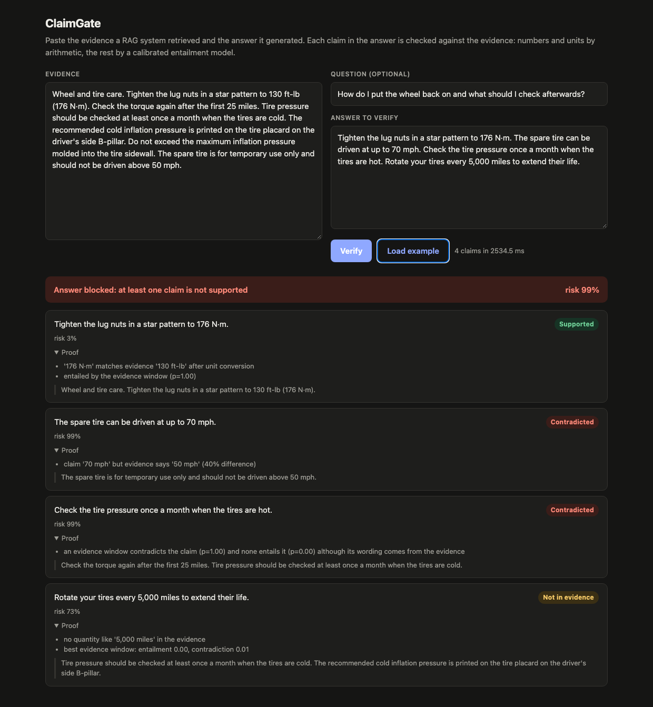

# ClaimGate

ClaimGate checks an answer from a retrieval-augmented LLM against the evidence that was retrieved for it, one claim at
a time, before the answer reaches a user. Numbers and units are checked with arithmetic. Everything else is checked by
an entailment model and a calibrated risk model. Every verdict comes with its proof and the evidence window it was
judged against.

It is evaluated on **DelucionQA** (Bosch Research, EMNLP 2023 Findings): hallucination detection for a RAG assistant
answering questions from a car owner's manual, labelled sentence by sentence by people.

## Results

### DelucionQA test set (671 answers)



| System | Test macro F1 | 95% CI | Test AUC |
|---|---|---|---|
| Keyword-match (paper) | 52.77 | | |
| Sim-cosine (paper) | 69.45 | | |
| Sim-hybrid (paper) | 70.81 | | |
| **Sim-overlap (paper, best published)** | **71.09** | | |
| Sim-overlap, rerun here on the rebuilt contexts | 71.00 | 67.4 to 74.4 | |
| Local LLM judge, Qwen2.5-7B-Instruct 4-bit, zero-shot | 73.09 | 69.5 to 76.6 | 0.811 |
| NLI zero-shot, DeBERTa-v3-large | 75.54 | 72.0 to 79.0 | 0.838 |
| **ClaimGate** | **76.41** | **73.0 to 79.6** | **0.853** |

* ClaimGate is 5.3 points above the best published number. Against Bosch's method rerun on the same 671 answers, the
  paired bootstrap difference is +5.4 points (95% CI 2.1 to 8.6, p < 0.001).
* On the 630 test answers whose rebuilt context has no unknown word, ClaimGate scores 76.22.
* The local 7B LLM judge is not significantly better than Sim-overlap (p = 0.17). Added to ClaimGate as one more
  feature, it did not help in cross-validation on train, so it is not part of the model.
* Sentence-level calibration error (ECE) on test is 0.022, so a reported risk of 30% means roughly that.

Ablations (same protocol; full table in [results/delucionqa.md](results/delucionqa.md)):

| Variant | Test macro F1 | Test AUC |
|---|---|---|
| ClaimGate | 76.41 | 0.853 |
| without the contradiction gate | 76.69 | 0.859 |
| without NLI features | 76.93 | 0.850 |
| without quantity checks | 76.10 | 0.852 |
| with the LLM judge as a feature | 76.02 | 0.851 |

All variants are inside each other's confidence intervals on this test set. The choices were made on train
cross-validation and dev, not on these numbers: NLI raised answer-level AUC in train CV, and the contradiction gate
costs 0.3 points here but catches flipped instructions that DelucionQA barely contains (next section).

### QuantStress: controlled edits of supported claims

DelucionQA has few wrong numbers and almost no contradictions; most of its hallucinations are true-sounding advice
that the manual never gives. To test the failure types that matter most for a manual (a wrong torque, a flipped
"do not"), `scripts/quantstress.py` takes dev and test sentences that annotators marked Supported and edits them by
rule, up to 400 per edit type (111 sentences had a unit-bearing value the edits could change):



| Share of claims flagged | original (should pass) | unit converted (should pass) | value shifted | unit swapped | negation flipped | condition swapped |
|---|---|---|---|---|---|---|
| NLI zero-shot, no unit canonicalisation | 5.8% | 18.9% | 73.9% | 45.0% | 71.5% | 58.0% |
| NLI zero-shot | 5.8% | 3.6% | 65.8% | 51.4% | 71.5% | 58.0% |
| ClaimGate without contradiction gate | 6.2% | 1.8% | 95.5% | 92.8% | 25.8% | 13.2% |
| **ClaimGate** | **6.5%** | **1.8%** | **97.3%** | **94.6%** | **66.2%** | **47.8%** |

* Rewriting converted values into the evidence's units cuts false alarms on correct conversions from 18.9% to 3.6%.
* The pint-based checker raises detection of wrong values from 66% to 97% and of swapped units from 51% to 95%.
* Without the contradiction gate, the learned model missed most flipped negations and conditions, because those
  edits keep the wording intact. The gate raises them to 66% and 48%. Plain NLI still catches somewhat more of
  them; it is also 0.9 points worse on DelucionQA.

QuantStress is rule-generated and reproducible (seeded). It measures specific failure types and is not a replacement
for human-labelled data.

### Abstaining on close calls



When ClaimGate defers the answers closest to its threshold to a person, accuracy on the rest goes from 77.5% (deciding
everything) to 84.5% at 80% coverage and 91.4% at 50%. The service flags those cases as `REVIEW`; the band is sized on
dev so about 20% of answers land there.

### Out of domain: RAGTruth question answering (900 test responses)

The same model, trained only on car-manual answers, applied to RAGTruth's web-search QA responses (Niu et al., ACL
2024). Response-level precision, recall and F1 for the hallucinated class, as in the paper. Only the threshold was
re-picked on 300 random RAGTruth train responses; the model was not retrained.

| System | Precision | Recall | F1 |
|---|---|---|---|
| Prompted gpt-3.5-turbo (paper) | 18.8 | 84.4 | 30.8 |
| SelfCheckGPT with gpt-3.5-turbo (paper) | 35.0 | 58.0 | 43.7 |
| Prompted gpt-4-turbo (paper) | 33.2 | 90.6 | 45.6 |
| Llama-2-13B fine-tuned on RAGTruth train (paper) | 61.6 | 76.3 | 68.2 |
| ClaimGate, DelucionQA threshold | 27.8 | 91.9 | 42.7 |
| ClaimGate, threshold from 300 RAGTruth responses | 31.2 | 83.8 | 45.5 (95% CI 40.4 to 50.5) |

Out of domain, ClaimGate is level with prompting GPT-4-turbo while running locally with no API calls. It is far from a
model fine-tuned on RAGTruth itself, which is what a deployment on a new domain should expect: the grounding signals
transfer, the labelling convention does not. ROC AUC is 0.768.

## What goes in and what comes out

```
POST /verify
{
  "evidence": "... Tighten the lug nuts in a star pattern to 130 ft-lb (176 N·m). Check the torque again after the first 25 miles.
               Tire pressure should be checked at least once a month when the tires are cold. ...
               The spare tire is for temporary use only and should not be driven above 50 mph.",
  "question": "How do I put the wheel back on and what should I check afterwards?",
  "answer":   "Tighten the lug nuts in a star pattern to 176 N·m. The spare tire can be driven at up to 70 mph.
               Check the tire pressure once a month when the tires are hot. Rotate your tires every 5,000 miles to extend their life."
}
```

Actual output of the shipped model (abridged):

```
verdict: BLOCK
  SUPPORTED        risk 0.03  "Tighten the lug nuts in a star pattern to 176 N·m."
                   '176 N·m' matches evidence '130 ft-lb' after unit conversion; entailed by the evidence window (p=1.00)
  CONTRADICTED     risk 0.99  "The spare tire can be driven at up to 70 mph."
                   claim '70 mph' but evidence says '50 mph' (40% difference)
  CONTRADICTED     risk 0.99  "Check the tire pressure once a month when the tires are hot."
                   an evidence window contradicts the claim (p=1.00) and none entails it (p=0.00)
                   although its wording comes from the evidence
  NOT_IN_EVIDENCE  risk 0.73  "Rotate your tires every 5,000 miles to extend their life."
                   no quantity like '5,000 miles' in the evidence; best window: entailment 0.00
```



An answer passes only if every claim is supported. Claims whose calibrated risk sits close to the decision threshold
are flagged for review instead of guessed.

## How it works

```
answer ──► split into claims ──► for each claim:
                                   1. quantities   pint-based extraction and unit conversion; a value or unit that
                                                   disagrees with a related evidence sentence is CONTRADICTED, with
                                                   the arithmetic as proof
                                   2. canonicalise claim values that equal an evidence value after conversion are
                                                   rewritten into the evidence's own units, so "176 N·m" is not judged
                                                   unsupported against "130 ft-lb"
                                   3. evidence     NLI (DeBERTa-v3-large) over the best evidence windows and over
                                                   long chunks; lexical novelty; embedding similarity (bge-small)
                                   4. decide       calibrated logistic regression -> risk; overrides from step 1 and
                                                   from the contradiction gate (wording matches the evidence, NLI says
                                                   contradicted, nothing entails it); review band around the threshold
answer verdict = PASS | BLOCK | REVIEW   (an answer is as strong as its weakest claim)
```

Design choices that came from measurements, not taste:

* **Logistic regression over gradient boosting.** In 5-fold grouped cross-validation on the train split, logistic
  regression beat boosting on every feature set.
* **Answer risk = riskiest claim.** Noisy-OR and a stacked answer model had slightly higher AUC on train CV but not
  higher macro F1, so the simpler, explainable rule stayed.
* **Thresholds come from dev, models from train, test is scored once per system.**

## Rebuilding DelucionQA

Bosch released the retrieved contexts as word ids, and the crawler that turns them back into text no longer works
because mopar.com blocks automated browsers. ClaimGate rebuilds the text from the passages that RAGBench republished.
The mapping has zero conflicts and zero alphabetical-order inversions over 4,833 recovered ids. Bosch's own Sim-overlap
method, rerun on the rebuilt data, scores 71.00 test macro F1 against the published 71.09. Details:
[docs/data.md](docs/data.md).

## Reproduce

Requires Python 3.12 and poppler (`pdftotext`). Timings are for an Apple M5 with 16 GB.

```bash
make setup          # venv + dependencies
make data           # DelucionQA, RAGBench passages, manual PDF -> data/delucionqa/*.jsonl   (~2 min)
make models         # DeBERTa-v3-large NLI + bge-small (~1 GB)
make features       # NLI over all splits, cached in artifacts/                           (~1 hour)
make evaluate       # trains on train, thresholds on dev, writes results/delucionqa.{json,md}
make stress         # QuantStress
make test           # unit + API tests (stub NLI, no weights needed)
```

The LLM-judge baseline needs `pip install mlx mlx-lm` (Apple silicon), `python scripts/fetch_models.py llm` (4.3 GB)
and `python scripts/llm_scores.py` (about 1 hour for all splits). `python scripts/evaluate_ragtruth.py` runs the
out-of-domain check (about 1 hour of NLI).

## Run the service

```bash
make serve          # http://localhost:8060  (UI at /, API at POST /verify, health at /health)
```

Open `http://localhost:8060/#example` to load and run the example above.

## Limitations

* **Rebuilt, not original, contexts.** 41 of 671 test contexts contain words the rebuild could not recover (99.88% of
  test tokens are recovered), and contexts that RAGBench did not carry verbatim were re-cased by rule. Bosch's own
  method lands within 0.1 points of its published score on this data, and ClaimGate's score on the 630 complete
  contexts is reported next to the full number, but this is still a rebuild.
* **Trained on one labelling convention.** DelucionQA counts true but unstated advice as hallucinated. The model learned
  that convention from 1,151 training answers; a deployment with a different policy needs its own threshold, at least.
* **One test set, wide intervals.** With 671 test answers the 95% interval is about ±3.3 points, so ablation
  differences below that are not meaningful. Model choices were made on train cross-validation and dev for that reason.
* **QuantStress is synthetic.** It shows whether specific edits are caught; it does not estimate how often such errors
  occur in real answers.
* **Contradictions inside paraphrase are still missed sometimes.** The gate catches 66% of flipped negations and 48% of
  swapped conditions; plain NLI catches a little more of those but is worse overall.
* **Claims are sentences.** A sentence with two facts gets one verdict. Splitting into atomic claims with an LLM is a
  natural next step but was not evaluated here.
* **No fine-tuned verifier.** Fine-tuning DeBERTa-v3-large on the train split diverged (NaN loss) and ran at 0.4 pairs/s
  on Apple MPS, so every model here is used zero-shot except the small logistic regression on top.
* **Speed.** On an M5 (16 GB), with an empty NLI cache, a real DelucionQA answer takes 0.98 s median (about 380 ms per
  claim) and 4.6 s at the 90th percentile; NLI over long evidence chunks dominates. Repeated evidence is cached.

## Licence

Code: MIT. No dataset or manual text is redistributed here; see [docs/data.md](docs/data.md) for the sources and their
licences.
